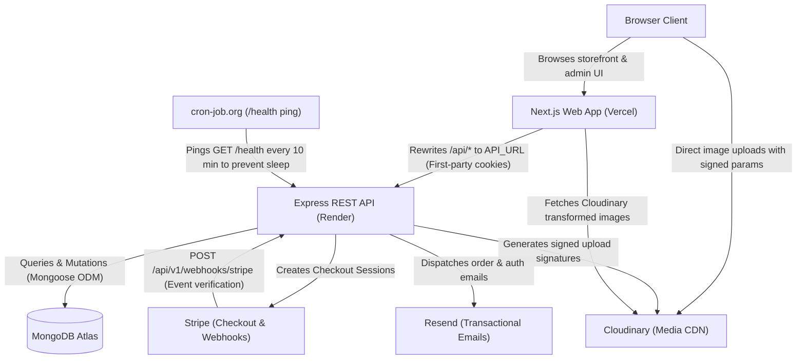

# Architecture Overview

YourStore is a production-ready, multi-category e-commerce platform built as a TypeScript monorepo using npm workspaces. The architecture decouples the customer-facing frontend from the backend services, using Next.js App Router for high-performance server-side rendering, ISR, and dynamic API rewriting, alongside a stateless Express REST API backed by MongoDB Atlas, Cloudinary, Stripe, and Resend.

---

## System Architecture

---

## Monorepo Structure

### `apps/web`
- **Framework:** Next.js 15 (App Router), React 19, Tailwind CSS.
- **Responsibilities:**
  - Responsive storefront with ISR (`revalidate: 60`), static category pages, dynamic product filtering, cart, and checkout.
  - Role-guarded administrative dashboard (`/admin`), order management, CSV product import, and KPI analytics.
  - Next.js rewrites proxying `/api/*` to Render, preserving `httpOnly` secure cookies on a single domain.

### `apps/api`
- **Framework:** Express 4, Mongoose 8, Pino logging, Zod validation.
- **Responsibilities:**
  - Stateless RESTful services with JWT authentication (access & refresh tokens in `httpOnly` cookies).
  - Business logic: atomic stock reservations, coupons, server-side order calculation, and CSV preview/import.
  - Integrations: Stripe webhook verification, signed Cloudinary asset management, and Resend email pipelines.

### `packages/shared`
- **Purpose:** Single source of truth shared across web and API.
- **Responsibilities:**
  - Zod schemas and TypeScript types for requests, responses, models, queries, and mutations.
  - Domain constants: categories, order statuses, listing types, and Cloudinary image presets.
  - Pure utility functions such as `imageUrl` transformation builders.

---

## Checkout Request Flow

1. **Initiation:** The customer submits `/api/v1/checkout/stripe` or `/api/v1/checkout/cod` with their selected delivery address and optional coupon.
2. **Atomic Stock & Order Creation:** The API verifies stock availability atomically (`$gte: qty`, `$inc: -qty`), computes authoritative totals server-side, and persists the `Order` with status `PendingPayment`.
3. **Payment Session:** For Stripe payments, the API constructs a Stripe Checkout Session containing the `orderId` in its metadata and returns the checkout URL.
4. **Asynchronous Webhook Fulfillment:**
   - Once payment completes, Stripe invokes `POST /api/v1/webhooks/stripe`.
   - The API verifies the cryptographic signature with `STRIPE_WEBHOOK_SECRET` and checks `WebhookEvent` for duplicate event IDs.
   - Upon `checkout.session.completed`, the order transitions from `PendingPayment` to `Placed`.
   - A confirmation email with receipt details is dispatched via Resend.
   - If a session expires or fails, the API releases the reserved stock back to the product inventory.
